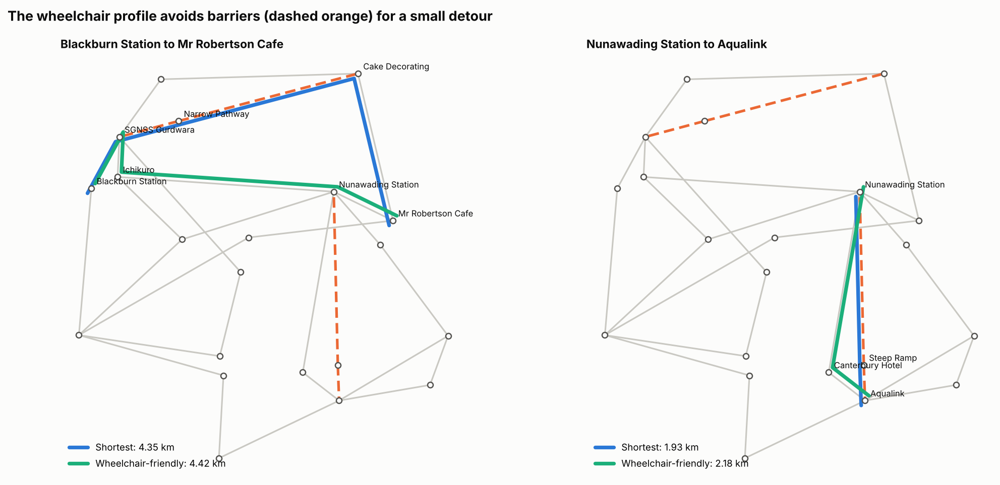
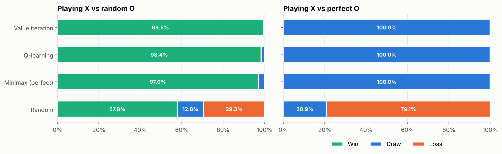

# AI Projects

Artificial intelligence projects in Python: search, planning and reinforcement learning. Each folder is a self-contained project with its own README, code, tests and charts.

## Projects

| Project | What it answers | Tools |
|---|---|---|
| [Wheelchair Route Planner](wheelchair-route-planner/) | How do you plan routes that avoid steep ramps and narrow paths, and how much faster is A* than Dijkstra? | Python, A* search, Dijkstra, pytest, Matplotlib |
| [Tic-Tac-Toe: DP vs RL](tic-tac-toe-rl/) | Does an agent trained by Q-learning or value iteration hold up against a perfect opponent? | Python, MDPs, value iteration, Q-learning, minimax, pytest |

## Highlights

**Wheelchair Route Planner:** 36 of 342 shortest routes between real places around Forest Hill and Blackburn cross a steep ramp or narrow path. The wheelchair profile reroutes all of them for only 70 to 250 m extra, and A* stays optimal on all 420 start and goal pairs.

**Tic-Tac-Toe: DP vs RL:** Every trained agent draws against a perfect opponent, but an exact search finds a winning line against 11 of 20 Q-learning agents. Value iteration can never lose.

## Running a project

    cd <project-folder>
    pip install -r requirements.txt
    jupyter notebook
