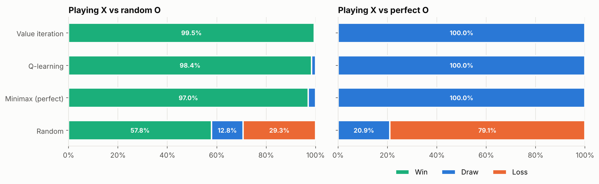
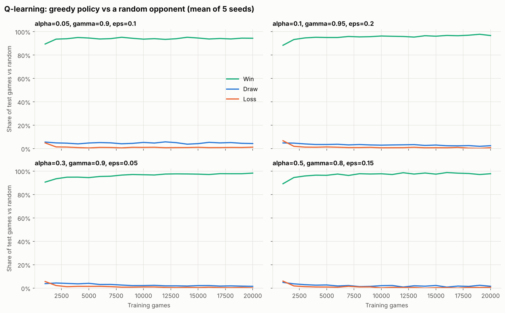
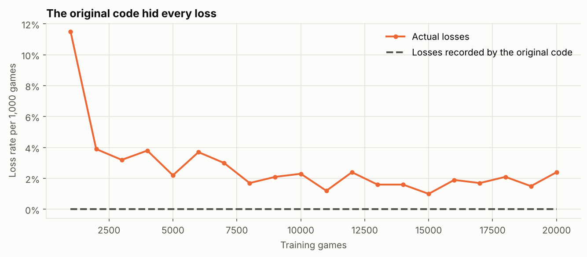

# Tic-Tac-Toe: Dynamic Programming vs Reinforcement Learning

Teaching an agent to play tic-tac-toe two ways, **value iteration** (solving it as a Markov Decision Process) and **Q-learning** (learning from experience), then testing whether a perfect opponent can beat them.



## The question

If an agent learns by playing a random opponent, how good does it really get, and can a smarter opponent exploit it?

## Approach

- **Game engine** ([`game.py`](game.py)): rules, turn order, and all 5,478 legal positions
- **Agents** ([`agents.py`](agents.py)):
  - **Random:** picks any empty cell
  - **Minimax:** perfect play, using memoised game-tree search
  - **Value iteration:** solves the MDP of X against a random O (2,423 decision states, converges in 4 sweeps)
  - **Q-learning:** tabular and epsilon-greedy, trained against a random O
- **Experiments:**
  - 4 hyperparameter settings x 5 seeds = 20 Q-learning runs of 20,000 games, with the greedy policy tested every 1,000 games
  - Head-to-head matches against random and perfect opponents
  - An **exact worst-case check** that searches every possible opponent strategy

## Key findings

| Finding | Detail |
|---|---|
| Value iteration beats random play best | 99.5% wins, more than perfect minimax (97.0%), because it's optimised to exploit a random opponent |
| Q-learning gets close without a model | 98.4% wins for the best setting (alpha 0.3, gamma 0.9, epsilon 0.05) |
| Every learned agent draws against perfect play | 100% draws in 5,000 games against minimax, the best possible result |
| But many Q-learners can be beaten | An exact search finds a winning line against **11 of 20** Q-learning agents, even though they all win 91 to 99% against random play |
| Value iteration can never lose | Its exact worst case against any opponent is a draw |

**Takeaway:** a high win rate against your training opponent doesn't mean the agent is robust. Q-learning only learns the positions it visits, and a random opponent rarely creates the dangerous ones.



## What I fixed from my first version

This started as a university assignment. Rebuilding it, I found and fixed:
1. **Losses were recorded as draws.** When the opponent won, the result was logged as a draw, so every training chart showed a 0% loss rate. The agent actually lost 11.5% of its first 1,000 games.
2. **Value iteration counted the final reward twice.** The empty board's value was 1.99, which is impossible when rewards are between -1 and +1. Fixed, it's 0.995.
3. **The state didn't record whose turn it was,** so the agent was asked to choose an X move in positions where it was O's turn.
4. **Q-updates bootstrapped from finished games,** and win rates were measured with random exploration still switched on.
5. **The comparison between the two methods was missing.** It's now the core of the project.



## Tests

```bash
pytest tests
```

The 7 tests check:
- the game rules
- the state count (5,478)
- that perfect play is a draw
- that minimax never loses
- that values are bounded between -1 and +1
- that value iteration wins and blocks correctly
- that Q-learning reaches more than 90% wins against random

## Run it

```bash
cd tic-tac-toe-rl
pip install -r requirements.txt
pytest tests
jupyter notebook tic_tac_toe_rl.ipynb
```

The notebook runs in under a minute.

## Limitations

- Both learners were trained only against a random opponent. Self-play or training against minimax would fix the exploitable gaps, and is the natural next step.
- The agents only play X (first).
- Tabular methods only work for small games. Larger games need function approximation, e.g. deep Q-networks.

## References

[1] R. S. Sutton and A. G. Barto, *Reinforcement Learning: An Introduction*, 2nd ed. MIT Press, 2018.

[2] C. J. C. H. Watkins and P. Dayan, "Q-learning," *Machine Learning*, vol. 8, pp. 279–292, 1992.

---
Originally built for an advanced algorithms unit at Deakin University, then rebuilt with bug fixes, a minimax opponent, worst-case analysis and tests.

[← Back to all projects](../README.md)
