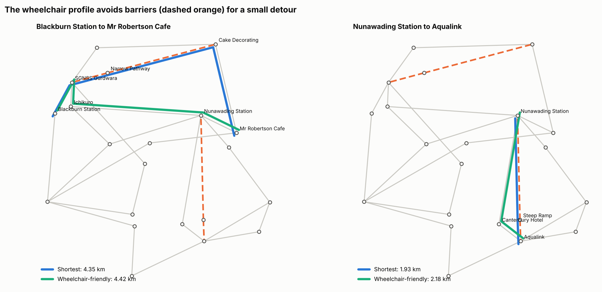
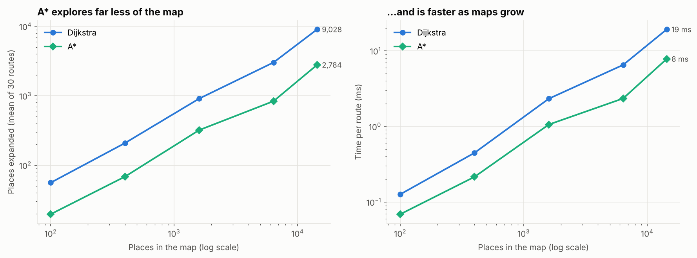

# Wheelchair-Friendly Route Planner (A* Search)

Route planning that avoids steep ramps and narrow footpaths for wheelchair users, built on a real area of Melbourne, with A* and Dijkstra implemented from scratch and compared.



## The problem

Standard map apps route by shortest distance or time. They don't account for barriers like steep ramps or narrow footpaths, which can make a "shortest" route unusable for someone in a wheelchair.

## What it does

- Models **Forest Hill, Nunawading and Blackburn (Melbourne)** as a graph of 21 points and 30 path segments, using real coordinates, with steep and narrow segments marked
- Plans routes under three profiles:
  - **shortest:** distance only
  - **wheelchair:** barriers cost 2 to 3 times their length
  - **strict:** barriers are blocked
- Implements **A\*** with an admissible straight-line heuristic, and **Dijkstra** (uniform cost search), in [`planner.py`](planner.py)
- Gives plain-English directions with barrier warnings:

```
Route (wheelchair profile): Blackburn Station -> SGNSS Gurdwara -> Ichikuro -> Nunawading Station -> Mr Robertson Cafe
Distance: 4.42 km, about 53 min
```

## Key findings

| Finding | Detail |
|---|---|
| Shortest routes often cross barriers | 36 of 342 routes (11%) between destinations use a steep ramp or narrow footpath |
| Avoiding them is cheap | The wheelchair profile reroutes all 36, for only 70 to 250 m extra |
| A* is always optimal | It matches Dijkstra's cost on all 420 start/goal pairs |
| A* searches far less | It expands about a third as many places as Dijkstra, on maps from 100 to 14,400 places |
| A bad heuristic breaks A* | My first version (swapped coordinates plus a 15 km terrain penalty in the heuristic) returned non-optimal routes for 77 of 420 pairs; the fixed version has 0 |



## What I fixed from my first version

This started as a university assignment. Rebuilding it, I found and fixed:
1. **Swapped coordinates.** Longitude and latitude were read the wrong way round, so straight-line distances were wrong.
2. **Impossible segment lengths.** 15 of 30 estimated distances were shorter than the straight line between their ends. These were corrected (see `forest_hill_map.py`).
3. **An inadmissible heuristic.** The terrain penalty was added to the heuristic, which made A* return worse routes. Barrier avoidance now lives in the route cost, where it belongs.
4. **A crash when start and end are the same place.** This is now handled and tested.

## Tests

```bash
pytest tests
```

The 7 tests check that:
- segment lengths are valid
- the heuristic is consistent for every segment and goal
- A* matches Dijkstra on every pair
- A* never expands more places than Dijkstra
- the strict profile never uses a barrier
- a route from a place to itself works

## Project structure

```
├── forest_hill_map.py               # places, coordinates, segments, terrain
├── planner.py                       # A*, Dijkstra, routing profiles, directions
├── tests/test_planner.py            # pytest suite
├── wheelchair_route_planner.ipynb   # analysis and charts
├── images/
└── requirements.txt
```

## Run it

```bash
cd wheelchair-route-planner
pip install -r requirements.txt
pytest tests
jupyter notebook wheelchair_route_planner.ipynb
```

## Limitations

- Segment lengths are estimates, and only two barriers are mapped. A real tool would use surveyed accessibility data (e.g. OpenStreetMap kerb, incline and width tags).
- The terrain cost factors (3x steep, 2x narrow) are illustrative and should be set with wheelchair users.
- The scalability test uses generated grid maps, not a real street network.

---
Originally built for a computational intelligence unit at Deakin University, then rebuilt with corrected data, a fresh implementation and tests.

[← Back to all projects](../README.md)
